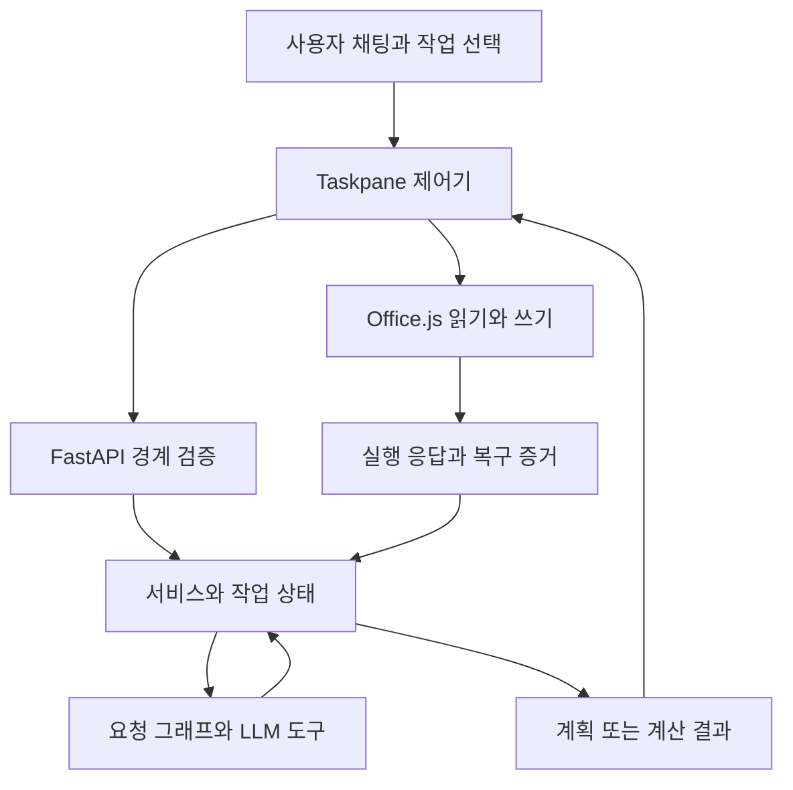
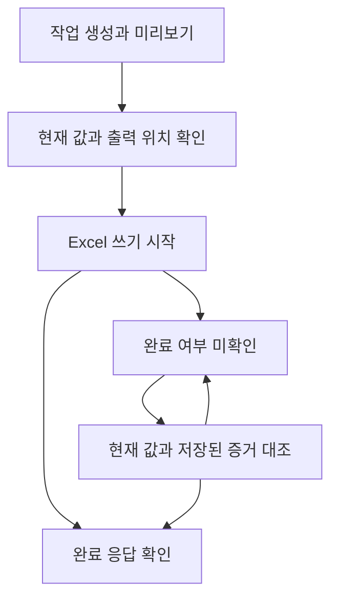
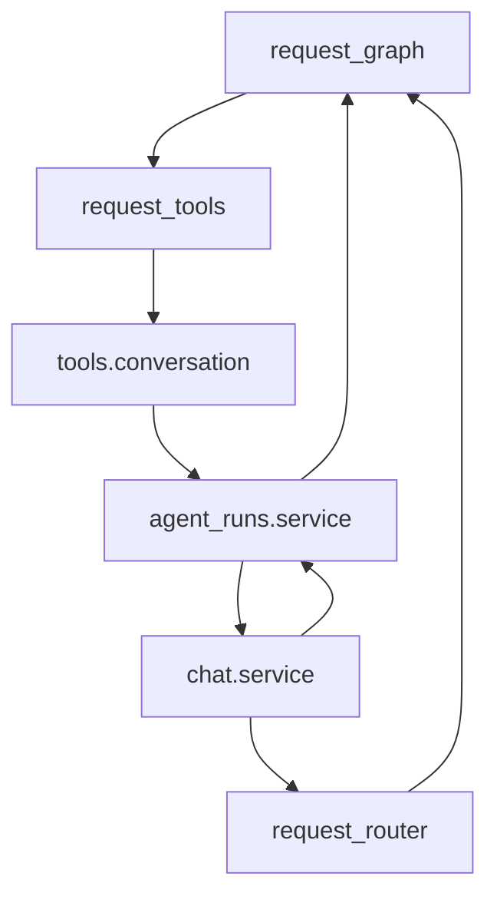

# KCS Harness Codebase Audit

작성일: 2026-11-25 · 기준 커밋: `482e623` · 대상: 현재 작업 트리의 실제 구현

## 1. 판단

**현재 코드는 AI가 작은 변경을 만들고 사람이 검토하는 개발에는 활용할 수 있다. 그러나 테스트 통과만을 조건으로 PR을 자동 병합하는 단계에는 아직 부족하다. 전체 재작성은 권하지 않는다.**

이 판단의 근거는 다음과 같다.

- API, LLM 도구, 도메인 계산, Excel 입출력이 이미 상당 부분 분리되어 있다. 순수 계산 함수와 모의 Excel 호스트를 활용하는 테스트도 충분히 출발점이 된다.
- 반면 원본 행 연결과 수식 참조 검증에서 실제 오동작을 재현했다. Python과 JavaScript의 동일 조건 계약도 일치하지 않는 경우가 있다. 기존 테스트가 모두 통과해도 이 사례들은 발견되지 않는다.
- 대화, AgentRun, OperationJob, FormulaJob, Excel 메타데이터가 서로 다른 곳에서 갱신된다. 쓰기 복구 장치는 있지만, 상태 전환의 소유권과 완료 기록의 기준이 분산되어 있다.
- PDF 상세 내용을 모델에서 제외하는 개선은 현재 코드에 존재한다. 그러나 일반 조회 결과는 중복해서 모델 컨텍스트에 들어간다. PDF 최적화만으로 전체 입력 크기 문제가 해결되지는 않는다.
- 저장소 내 자동 검증 파이프라인과 Python–JavaScript 공통 계약 검증이 부족하다. 소스 탐색 시 비활성 기능, 지연 import, 전역 JavaScript 객체 때문에 변경 경계를 오해하기 쉽다.

권장 순서는 **검증 기준 고정 → 재현된 데이터 오류 수정 → 컨텍스트·상태 계약 정리 → 복잡한 함수 분리 → 자동화 범위 확대**다. 영속화는 무중단 사용·자동 배포를 준비할 때 필요하며, 지금 모든 개발 작업의 선행 조건으로 삼을 필요는 없다.

## 2. 조사 범위와 검증 수준

기존 소스, 테스트, 프롬프트, 설정은 수정하지 않았다. 이 보고서만 새로 추가했다. 실제 Excel 통합문서, 실행 중인 서버, 로컬 LLM 설정도 변경하지 않았다.

조사는 문서 설명을 그대로 믿는 방식이 아니라 API 진입점에서 서비스, 도구, 프런트엔드 제어기, Office.js 쓰기 및 완료 응답까지 추적하는 방식으로 수행했다. Python AST로 함수 크기와 내부 import 관계를 조사했고, 기존 테스트와 별도의 작은 재현 검사를 실행했다.

| 항목 | 확인 결과 |
|---|---|
| 자체 Python 소스 | `src` 내 83개 파일, 7,656줄 |
| 자체 JavaScript 소스 | vendor 제외 38개 파일, 5,856줄 |
| 백엔드 테스트 | 37개 Python 파일, 319개 테스트 |
| 프런트엔드 테스트 | 26개 테스트 파일, 291개 테스트. 공통 CJS helper는 별도 |
| 프롬프트 | YAML 6개와 loader. 환경 설정 YAML은 별도 |
| 백엔드 실행 | 첫 실행 319개 중 환경 의존 오류 2개. 프록시 환경변수를 분리한 실행은 319개 통과 |
| 프런트엔드 실행 | 291개 모두 통과 |
| 별도 재현 | 원본 중복 행 순서 변경, 수식 참조 검증, 빈 값 필터 계약, AgentRun 완료 기록 누락, 모델 컨텍스트 중복 |
| 실행하지 않은 검증 | 실제 Office 호스트 통합 검사, 실제 Gemma 추론 평가, 대용량 부하 검사, 배포·재시작 시험 |

백엔드 첫 실행의 두 오류는 `test_internal_thinking`과 `test_prompt_startup`에서 모델 클라이언트를 생성할 때 발생했다. 호스트의 SOCKS 프록시 환경변수를 상속했으나 `socksio`가 없어 실패했다. 모델의 응답 품질 실패는 아니며, 테스트가 실행 환경에 영향을 받는 사례다. 환경을 분리한 실행은 10.422초, 프런트엔드는 약 4.408초였다. 코드 커버리지 비율은 측정하지 않았다.

이하 근거는 구분해서 읽어야 한다.

- **재현 확인**: 현재 코드에 합성 입력을 넣어 실제 결과를 확인했다. Excel 관련 재현은 저장소의 모의 호스트를 사용했다.
- **코드 확인**: 구현상 구조나 경로가 존재함을 확인했다. 모든 운영 환경에서 장애가 발생한다는 뜻은 아니다.
- **위험 추론**: 확인한 구조에서 발생할 수 있는 장애다. 부하·운영 실험을 수행한 것으로 표현하지 않았다.

심각도 **높음**은 잘못된 데이터 반영, 주요 기능 중단, 자동화 전 중요한 검증 공백을 의미한다. **중간**은 특정 조건에서 실패하거나 변경 영향 범위를 키우는 문제다. **낮음**은 주로 탐색·유지보수 비용이다. 확인하지 않은 원격 저장소의 브랜치 보호 정책이나 외부 CI 유무는 평가하지 않았다.

## 3. 전체 아키텍처와 실제 데이터 흐름

### 3.1 실행 구조

이 시스템은 서버 혼자 Excel 작업을 수행하는 구조가 아니다. **서버는 계획·검증·계산·상태를 담당하고, 실제 통합문서 읽기·쓰기·수식 계산은 Add-in이 담당한다.** 따라서 HTTP 성공, Excel 쓰기 성공, 작업 상태 확정은 서로 다른 사건이다.



`main.lifespan()`은 runtime, 대화 저장소, 두 종류의 Job 사전, PDF 추출 semaphore를 만든다. `api/router.py`가 기능별 API를 연결한다. LLM 모델과 프롬프트의 일부는 `runtime.create_runtime()`에서 생성한다. 내부망과 external 설정은 현재 같은 llama.cpp 어댑터 계열을 사용한다.

### 3.2 채팅 → 단일 작업

1. `chat/chat.js`가 현재 workspace와 요청 ID를 포함해 `/chat`으로 보낸다.
2. `services/chat/service.py::process_chat()`이 대화 잠금을 얻고 요청 ID 중복을 확인한다. 최근 10개 대화 turn과 작업 상태를 만든다.
3. `request_router.route_request()` → `request_graph.run_request_graph()`가 현재 작업에 허용된 도구를 구성한다. 모델은 Excel을 직접 조작하지 않고 도구 인자를 반환한다.
4. 그래프는 도구 인자 검증, 일부 ID 보정, 오류 재시도 후 `RequestDecision`에 해당하는 결정을 만든다.
5. `decision_action()`이 결정을 `configure_operation`, `confirm_selection`, `change_scope` 등의 UI action으로 바꾼다. `StoredTurn`에는 이 시점의 답변을 저장한다.
6. Taskpane이 해당 제어기로 action을 전달한다. 이후 계산·미리보기·적용은 별도 API와 Office.js 경로로 진행된다.

현재 `normalize_column_ids()`는 **현재 workspace에 동일 문자열 ID가 실제로 있을 때만** 정수 ID를 문자열로 바꾼다. 과거 로그의 숫자 `column_ids` 오류를 현재 코드에서도 그대로 방치하고 있다고 평가하지 않았다.

### 3.3 정제·유사도·그룹 작업 → Excel 반영

`operations/operations.js`가 입력 열, 행 범위, 현재 값, 출력 위치를 읽고 `operation_jobs` API를 사용한다. 백엔드 `jobs.preview_job()`은 일반 연산의 `execute()` 또는 거래처·모델 비교 함수를 호출한다. 전체 행을 LLM이 한 행씩 계산하는 구조가 아니다.

미리보기 승인 후 `begin_apply()`와 미확정 쓰기 검사를 거쳐 Excel 쓰기를 시작한다. Add-in은 원본 상태 및 쓰기 대상 정보를 확인하고 결과를 반영한다. 서버에는 완료 상태와 결과 정보를 전달하고, 통합문서에는 결과 열 및 의존성 메타데이터를 저장한다.



`UNKNOWN`은 무조건 실패나 재실행 허용을 뜻하지 않는다. `write_recovery`가 쓰기 전후 증거와 현재 값을 대조한다. 이러한 분기는 분산된 쓰기의 불확실성을 처리하므로 유지해야 한다.

### 3.4 여러 단계의 목표 실행

`start_agent` → `start_run()`으로 AgentRun을 만들고, 프런트엔드 `chat/agent.js`가 단계별 작업을 진행한다.

- `read_workspace`: Add-in이 실제 값을 읽고 receipt를 보낸다. 서버의 `read_result()`가 동일 값 조합별로 건수와 대표 행 ID를 집계한다.
- 후속 판단: `advance()`가 현재 관측, 이전 조회 결과, 완료 Job을 넣고 그래프를 다시 호출한다.
- 수정: 작업을 OperationJob 또는 FormulaJob과 연결하고 사용자의 미리보기 적용을 기다린다. 명시적인 대표 부호 그룹 연결에는 별도의 제한된 자동 적용 경로가 있다.
- 완료: `answer_question`에 대응하는 결정으로 `run.answer`와 `run.status`를 갱신한다. 이 최종 답변은 일반 `StoredTurn` 갱신과는 연결되지 않는다(A04).

현재 대표 부호 그룹 연결은 사용자 원문에서 100점 및 부호·코드 지시를 확인하고, 도구에서 관측된 결과를 검증한다. 모든 자동 그룹 작업을 아무 조건 없이 허용하는 구현은 아니다. 다만 후속 요약·도구 선택 자체는 여전히 모델 단계이므로, 프롬프트만으로 모든 종료 정책을 보장한다고 볼 수는 없다.

### 3.5 수식

`formula` 제어기가 입력 표본·참조 시트·출력 위치를 준비한다. `create_formula_job()`과 `generate_formula_plan()`은 구조화된 수식 계획을 만들고 원본·출력 범위·참조 시트를 검증한다. Add-in이 미리보기와 승인 후 수식을 실제 Excel에서 채우고 계산하며, 결과 값을 저장한다. 백엔드 테스트가 수식 문자열을 검증하는 것과 Excel이 수식을 계산하는 것은 별개다.

### 3.6 PDF와 조사 조건

업로드 → 별도 프로세스의 PDF 텍스트·표 추출 → `ReferenceDocument` 저장 → 조사 조건 추출 → 검토 시트 → 수정된 검토 내용 저장 순서다. 표 카탈로그 처리와 LLM 기반 조건 추출이 함께 존재한다. `extract_conditions()`는 새 상태를 준비한 후 성공 시 반영한다.

일반 모델 입력에서는 `model_context.overview()`가 조사 조건 원문과 근거 대신 개수·상태·검토 시트 위치를 제공한다. 필요할 때 `read_review_conditions` 또는 `read_pdf_source`를 호출하고, 이후 대화에는 조회 위치 요약을 남긴다. **원문을 한번 조회했다고 다음 작업마다 PDF 전체가 다시 붙는 구현은 아니다.** 계산에 필요한 확정 기준 목록은 별도 도메인 경로에서 사용한다.

### 3.7 AI 의견과 결과 의존성

`recommendation`은 대상 열을 읽고 값 조합·집계 정보로 의견을 생성한다. 구조화 호출의 분할·재시도 경로는 `models/structured.py`에 있다. 완료된 의견은 원래 대화 turn도 갱신한다. 이는 AgentRun 완료 기록 방식과 다르다.

작업표의 열·행 ID, 원본 보관본, 결과 의존성은 `workspace` 계열이 관리한다. `result_dependencies.js`는 입력 변경에 따른 결과 재검토 상태를 관리한다. 작업표 내부의 안정적인 행 ID와, 원본 시트에서 물리적 행 번호로 연결하는 경로는 구분해야 한다(A01).

## 4. 디렉터리와 모듈의 책임

| 위치 | 실제 책임 | 주요 연결·주의점 |
|---|---|---|
| [src/main.py](sandbox:/Users/bae/Desktop/workspace/vibe_coding/KCS_HARNESS/src/main.py), `settings.py`, `runtime.py` | 앱 초기화, 환경 설정, 모델 생성 | 프로세스 내 상태 저장소와 모델 클라이언트의 조립 지점 |
| `src/api/` | HTTP 요청·응답, 경계 검증, 서비스 연결 | Excel 조작 자체는 수행하지 않음. 일부 async 경로가 동기 계산을 직접 호출 |
| [src/agents/request_router.py](sandbox:/Users/bae/Desktop/workspace/vibe_coding/KCS_HARNESS/src/agents/request_router.py) | 요청 결정 검증과 라우팅 | `RequestDecision`이 agent service에서도 필요해 역의존 발생 |
| [src/agents/request_graph.py](sandbox:/Users/bae/Desktop/workspace/vibe_coding/KCS_HARNESS/src/agents/request_graph.py) | 모델 호출·도구 실행·검증 재시도 | 모델 컨텍스트 조립과 로그, ID 보정까지 담당 |
| `src/agents/tools/`, `request_tools.py`, `execution_tools.py` | 상황별 도구 노출 및 인자→결정 변환 | 도구를 추가해도 UI action과 실행 경로가 연결되지 않으면 기능 완성 아님 |
| `src/prompts/` | 요청·실행·수식·조사·조언 지침 | 코드의 도구 스키마와 함께 동작. 프롬프트 로딩 시점이 다름 |
| `src/models/` | OpenAI 호환·llama.cpp·Codex 어댑터, 구조화 호출 | provider별 응답 차이를 흡수. 모든 호출에 같은 입력 예산 정책이 적용되지는 않음 |
| [src/repositories/conversation_repository.py](sandbox:/Users/bae/Desktop/workspace/vibe_coding/KCS_HARNESS/src/repositories/conversation_repository.py) | 대화, 문서, 조사, run 저장과 잠금·취소 | 현재 구현은 메모리 저장소. Job 사전은 별도 |
| `src/services/chat/` | 대화 처리, workflow, UI action 변환 | 대화 turn과 작업 완료 기록의 경계가 분리됨 |
| `src/services/agent_runs/` | 목표 실행 단계, receipt, Job 연결·재개 | 여러 서비스와 그래프를 조정하는 중심 모듈 |
| `src/services/operations/` | 연산 계약, 전처리·그룹·규격 계산, Job | 순수 계산과 Job 상태가 파일 단위로 분리된 점은 유리 |
| `supplier_matching.py`, `model_matching.py`, `similarity.py` | 기준 검증, 거래처 매칭, 모델명 매칭, 문자열 유사도 | 비교 의미가 서로 달라 하나의 알고리즘으로 합치면 안 됨 |
| `src/services/formula/` | 수식 계획·검증·미리보기·상태 | Excel 계산은 프런트엔드. 정규식 원본 참조 검증 결함 확인 |
| `src/services/documents/` | PDF 입출력·추출·표·청크 | 추출을 subprocess로 분리. 실패 원인 전달은 부족 |
| `src/services/investigation/` | 조건 추출·검토·revision·문서 연결·모델용 요약 | `investigation_context()`가 조회용 생성과 상태 변경을 겸함 |
| `src/services/recommendation/` | 의견 대상 선택·집계·생성·진행 상태 | 별도 advice model과 원래 대화 turn 갱신 경로 |
| `execution_history.py`, `write_recovery.py` | 완료 이력 투영, 쓰기 증거·복구 | 사용자-visible 상태와 모델 입력용 상태의 중요한 경계 |
| `src/static/excel/taskpane.*` | DOM 구성·script 순서·제어기 조립 | 전역 객체 기반이며 로드 순서에 의존 |
| `src/static/excel/workspace/` | 작업표 생성·읽기·열 관리·원본 연결·의존성·저장 | `workspace.js`가 제어와 상태를 많이 보유 |
| `src/static/excel/chat/` | 채팅 UI, AgentRun 단계 실행·결과 표시 | 대화 API 외에 화면에서만 덧붙이는 메시지 존재 |
| `src/static/excel/operations/`, `formula/` | 미리보기·적용·Office.js 입출력·복구 | 서버 Job과 Excel 상태를 이어주는 핵심 경계 |
| `documents/`, `recommendation/`, `similarity/` | PDF 검토 화면, 의견·유사도 기능별 제어 | workspace의 ID와 결과 열 계약에 의존 |
| `group_review/`, `services/group_review.py` | 보류된 묶음 검토 기능 | 코드와 테스트는 남아 있지만 현재 Taskpane 연결은 비활성 |
| `tests/backend/`, `tests/frontend/`, `tests/helpers/` | Python 단위·API 테스트, JS 모의 DOM/Excel 테스트 | 실제 Office·모델 시험을 대신하지는 않음 |
| [scripts/evaluate_routing.py](sandbox:/Users/bae/Desktop/workspace/vibe_coding/KCS_HARNESS/scripts/evaluate_routing.py), `evaluate_agent.py` | 실제 모델 대상 평가 도구 | 단위 테스트와 별도. 이번 감사에서는 실행하지 않음 |
| `docs/`, [README.md](sandbox:/Users/bae/Desktop/workspace/vibe_coding/KCS_HARNESS/README.md) | 사용법·설계·개발 이력 | 과거 구조 설명과 현재 활성 기능을 구분할 필요 |

## 5. 의존성 및 순환 참조

정상적인 큰 방향은 `API → service → 계산/schema`, `agent → tool → schema/service`, `UI controller → sheet adapter`다. 그러나 대화와 AgentRun 실행 부분은 양방향 의존이 생겼다.

Python의 함수 내부 import까지 포함한 AST 분석에서 다음 6개 모듈이 하나의 강연결요소에 포함된다.

`agents.request_graph`, `agents.request_tools`, `agents.tools.conversation`, `services.agent_runs.service`, `agents.request_router`, `services.chat.service`.

대표 순환은 다음과 같다.



`conversation.start_agent()`가 그룹 지시 검증 함수를 agent service에서 가져오고, `agent_runs.advance()`는 graph, router의 결정 타입, chat의 context/action 함수를 함수 내부에서 import한다. `process_chat()`도 agent service를 지연 import한다.

**현재 시작 시 ImportError가 발생한다는 뜻은 아니다.** 지연 import 덕분에 실행되고 테스트도 통과한다. 문제는 변경의 방향과 소유권이 불명확하여 모델 호출 또는 상태 계층을 독립적으로 바꾸기 어렵다는 점이다(A08).

내부 import를 받는 횟수가 많은 모듈은 `services.errors` 25개, `operations.schemas` 19개, `debug_log` 14개, `formula.schemas` 11개였다. 공통 오류·로그 모듈의 높은 참조 수 자체는 문제로 보지 않는다. 업무별 선택 필드와 검증을 함께 담은 `operations.schemas`는 변경 영향을 더 주의해야 한다.

JavaScript는 `window.*`와 수동 script 순서가 의존성을 표현한다. 예를 들어 `operations_sheet.js`는 파일 평가 시점에 `window.workspaceTable.batchSize`를 읽는다. Python과 같은 정적 import 그래프로 모든 JS 의존성을 검증할 수 없으며, 이번 감사에서 JS 순환 참조 개수를 산출했다고 주장하지 않는다.

## 6. 문제 요약

| ID | 문제 | 심각도 | 근거 수준 |
|---|---|---|---|
| A01 | 원본의 중복 행 재정렬 후 새 열이 다른 행에 결합됨 | 높음 | 모의 Excel 재현 |
| A02 | 수식 참조 검증이 정상 수식을 거절하고 문자열을 참조로 인정 | 높음 | 순수 함수 재현 |
| A03 | 빈 비교값의 Python/JS 필터 계약 불일치 | 중간 | 양쪽 검증 재현 |
| A04 | AgentRun 최종 답변이 일반 대화 기록에 반영되지 않음 | 중간 | API·모의 모델 재현 |
| A05 | 조회 결과 중복 입력과 총 컨텍스트 예산 부재 | 높음 | 중복 재현·코드 확인 |
| A06 | 대화 잠금이 모델 대기까지 유지되고 async 경로에 동기 계산 존재 | 중간 | 잠금 대기 재현·코드 확인 |
| A07 | 메모리 상태의 수명·정리·배포 재시작 정책 부재 | 중간, 자동 운영 전 높음 | 코드 확인 |
| A08 | agent·chat·graph 사이의 논리적 import 순환 | 중간 | AST·코드 확인 |
| A09 | 상태 전환의 소유권 분산과 조회 함수의 상태 변경 | 중간 | 코드 확인 |
| A10 | 연산 종류 증가에 취약한 다목적 계약과 조정 함수 | 중간 | 코드·구조 측정 |
| A11 | 프런트엔드 전역 객체·수동 로드 순서와 혼합 책임 | 중간 | 코드 확인 |
| A12 | 보류 기능과 활성 기능의 혼재 | 낮음 | 연결 경로·테스트 확인 |
| A13 | 서로 다른 실패를 일반 모델 오류로 축약하고 일부 진단 소실 | 중간 | 예외 경로 확인 |
| A14 | 자동 병합을 뒷받침할 재현 가능한 검증 게이트 부족 | 높음, 자동 병합 기준 | 테스트 실행·저장소 확인 |
| A15 | 프롬프트별 로딩 시점이 달라 실행 버전이 섞일 수 있음 | 낮음 | 코드 확인 |

## 7. 문제별 상세 근거와 개선 방향

### A01. 중복 행의 원본 순서가 바뀌면 새 열이 잘못 연결된다

**파일·함수:** [src/static/excel/workspace/source_columns.js:51](sandbox:/Users/bae/Desktop/workspace/vibe_coding/KCS_HARNESS/src/static/excel/workspace/source_columns.js)의 `readLive()`, `sourceLinks()`, `writeColumn()`, `append()`.

**근거:** 현재 원본에는 안정적인 행 ID가 없어, 원본 보관본의 행 번호 및 이미 보관한 열의 값으로 순서를 검증한다. 비교 열의 값이 동일한 두 행을 바꾸면 검증은 통과하지만, 새 열의 값은 바뀐 물리적 위치에서 읽는다. 주석에도 중복 행 재정렬을 검출할 수 없다고 명시되어 있다.

재현 입력은 원본의 `(금액, 모델)` 두 행 `(10, SAME)`, `(20, SAME)`이다. 모델 열만 작업표로 가져온 뒤 원본 두 행의 순서를 바꾸고 금액 열을 추가했다.

| 항목 | 결과 |
|---|---|
| 원래 행 ID와 기대 금액 | `(2, 10)`, `(3, 20)` |
| 실제 결합 결과 | `(2, 20)`, `(3, 10)` |
| 검증 오류 | 발생하지 않음 |

**심각도·장애:** 높음. 작업표의 다른 속성이나 기존 결과에 잘못된 금액·거래처 속성이 붙어 후속 계산이 오염될 수 있다. 일반적인 작업표 내부 정렬 전체가 고장 났다는 의미는 아니며, 처음 선택하지 않은 원본 열을 나중에 live 경로로 가져오는 경우다.

**개선 방향:** 나중에 열을 결합할 수 있어야 한다면 원본의 고유 업무 키 또는 안정적인 행 식별자를 함께 확보해야 한다. 키가 없는 경우는 최초 보관본에서만 가져오거나, 연결이 모호함을 판정해 명시적인 매핑을 요구해야 한다. 동일한 기존 값만으로 원래 행을 복원할 수 있다고 가정하면 안 된다.

**영향 범위:** 원본 보관 스키마, 새 열 가져오기, 기존 통합문서 호환, 관련 Office mock fixture. 거래처 유사도 알고리즘 자체는 변경 대상이 아니다. `test_investigation.cjs`에는 작업표 정렬과 원본의 식별 가능한 변경은 있으나 이 중복 원본 재정렬 사례가 없다.

### A02. 수식의 원본 참조 검증이 의미 대신 첫 셀 문자열을 확인한다

**파일·함수:** [src/services/formula/planner.py:20](sandbox:/Users/bae/Desktop/workspace/vibe_coding/KCS_HARNESS/src/services/formula/planner.py)의 `validate_source_reference()`, `generate_formula_plan()`.

**근거:** 사용자 지시에 `상품/재고/단가/조회/찾/lookup`이 있으면 선택 범위의 첫 셀만 정규식으로 찾는다. 문자열 리터럴은 제거하지 않는다. 같은 파일의 `validate_reference_sheets()`는 문자열을 제거하므로 검증 방식도 다르다.

선택 범위 `A2:B4`, 지시 `B열 값을 조회해서 결과로 써줘`, 출력 범위 `C2:C4`로 검사했다. 유효한 `FormulaPlan`을 만든 뒤 원본 참조 검증을 호출한 결과다.

| 수식 | 기대 | 실제 |
|---|---|---|
| `=B2` | 선택된 B열 참조로 인정 | A2가 없어서 거절 |
| `="A2"` | 실제 원본 참조가 없음 | 문자열에 A2가 있어 통과 |

**심각도·장애:** 높음. 정상 수식이 재생성·오류로 이어지거나, 원본을 읽지 않는 상수 수식이 이 검사를 통과한다. 실제 Excel 적용까지 실행한 재현은 아니며, 미리보기에서 사용자가 발견할 가능성은 남아 있다.

**개선 방향:** 입력 열과 요청에서 지정한 키를 명시적으로 연결하고, 지원하는 수식 문법에서 실제 셀 참조와 문자열을 구분한다. 모든 조회가 선택 범위 첫 셀을 참조해야 한다는 가정을 제거한다. 먼저 문자열 제외와 두 번째 입력 열 사례를 회귀 검사하고, 지원 범위에 맞는 참조 분석으로 확장한다.

**영향 범위:** 수식 planner·입력 계약·수식 프롬프트·참조 검증 테스트. 출력 범위 겹침 방지와 외부 참조 차단은 유지한다. Excel 수식 엔진을 새로 구현하는 방식은 권하지 않는다.

### A03. Python과 JavaScript가 같은 필터를 다르게 해석한다

**파일·함수:** [src/services/operations/schemas.py:65](sandbox:/Users/bae/Desktop/workspace/vibe_coding/KCS_HARNESS/src/services/operations/schemas.py)의 `RowFilter`; [src/static/excel/operations/operations_sheet.js:44](sandbox:/Users/bae/Desktop/workspace/vibe_coding/KCS_HARNESS/src/static/excel/operations/operations_sheet.js)의 `filterColumns()`, `compileFilter()`.

**근거:** `{"column_id":"c","operator":"equals","value":""}`는 Python 모델에서 허용된다. JS는 `blank/not_blank`가 아닌 비교값에 `trim()` 후 빈 값이 남으면 거절한다. 양쪽에 같은 입력을 넣어 Python 통과, JS `비교할 값을 확인하세요.` 오류를 확인했다.

**심각도·장애:** 중간. 서버와 LLM 도구가 유효하다고 판단한 계획이 Excel 실행 단계에서 실패한다. 프롬프트나 모델을 바꿔도 계약 불일치가 남는다.

**개선 방향:** 언어에 독립적인 조건 fixture를 만들어 Python과 JS가 같은 기대 결과를 검사하도록 한다. 빈 문자열, 공백, 비숫자, 소수, 복합 조건의 의미를 명시한다. `equals ""`와 공백까지 포함하는 `blank`는 의미가 다르므로 무조건 치환하지 않는다.

**영향 범위:** 행 범위 선택, 조건부 변경, 규격 조건, agent 읽기 조건. Python Decimal과 JS의 정밀 숫자 비교를 단순 Number 비교로 바꾸는 것은 개선이 아니다.

### A04. 화면의 AgentRun 최종 답변과 저장된 대화 이력이 다르다

**파일·함수:** [src/services/agent_runs/service.py:313](sandbox:/Users/bae/Desktop/workspace/vibe_coding/KCS_HARNESS/src/services/agent_runs/service.py)의 `advance()` 완료 분기; `src/services/chat/service.py::process_chat()`; `src/api/chat.py::read_conversation()`; `src/static/excel/chat/agent.js::flush()`.

**근거:** 최초 채팅 처리에서 turn을 저장한 뒤, AgentRun 완료 시에는 `run.answer`만 갱신한다. 화면은 최종 답변을 추가하지만 `/conversations/{id}`는 `conversation.turns`를 반환한다. 모의 모델로 `read_workspace → answer_question`을 수행한 결과 run은 `COMPLETED`이고 최종 답변도 있으나 대화 조회에는 그 답변이 없었다. `recommendation.service`는 원래 turn을 갱신하므로 완료 기록 정책이 다르다.

**심각도·장애:** 중간. 최종 결과 재표시, 과거 질의, 대화 기반 재현 및 회귀 평가가 화면과 달라진다. 최종 답변이 모든 서버 상태에서 사라진다는 뜻은 아니다. 현재 active run에는 남고 UI의 현재 run 조회 경로도 존재한다.

**개선 방향:** `origin_request_id`에 연결된 작업 완료 이벤트 또는 명시적인 최종 turn 갱신을 도입한다. UI 표시 기록과 모델에 전달할 축약 기록을 구분해, 이 문제를 고치면서 원문·대량 셀을 다시 매 turn 넣지 않도록 한다. 중복 receipt에 의한 완료 메시지 중복도 함께 검증한다.

**영향 범위:** 대화 저장 계약, agent 완료·재개, 채팅 렌더링, 모델 history builder. 별도 AgentRun 상태를 없애기보다 완료 사실의 투영을 일치시키는 변경이다.

### A05. 조회 데이터가 중복 입력되고 전체 모델 입력 예산이 없다

**파일·함수:** [src/services/agent_runs/service.py:145](sandbox:/Users/bae/Desktop/workspace/vibe_coding/KCS_HARNESS/src/services/agent_runs/service.py)의 `read_result()`, `advance()`의 268–290행; `src/agents/request_graph.py::run_request_graph()`; `src/services/investigation/model_context.py::model_task_context()`; `src/services/workspace.py::summarize_row_scopes()`.

**근거:** 일반 조회는 모든 고유 값 조합을 `groups`로 반환한다. `advance()`는 그 결과를 `observation`에 저장한 뒤 `read_results[].result`에도 깊은 복사하고 두 필드를 모델에 전달한다. 모의 모델이 받은 context에서 두 결과의 동등성을 확인했다. 조회를 계속하면 이전 조회 결과도 축적된다. 고유값이 많으면 집계가 거의 압축되지 않는다.

PDF 요약 함수는 조사 상세와 완료 관측의 PDF 기준 목록을 줄이지만 일반 조회 `groups/values`를 줄이지 않는다. 행 범위 요약 역시 행 ID 목록을 대상으로 한다. 최근 대화 10개, 실행 이력 10개, 그래프 반복 8회 등의 제한은 토큰 예산이 아니다. `model.input_size`는 문자 수를 기록하지만 전송 전 전체 토큰 예산을 강제하지 않는다. 구조화 추출의 `INPUT_BYTES` 분할은 이 그래프 경로에 자동 적용되지 않는다.

**심각도·장애:** 높음. 고유값이 많은 조회나 다단계 실행에서 모델 컨텍스트 초과·지연·비용 증가가 발생할 수 있다. 과거 로그의 83,512토큰을 현재 코드로 다시 측정한 것은 아니며, 이번 감사에서 확정한 것은 중복 입력과 예산 관리의 부재다.

**개선 방향:** 계산에 필요한 전체 결과는 서버에 보관하고 모델에는 결과 참조 ID, 열 정보, 건수, 목적에 맞는 집계와 필요한 조회 부분을 제공한다. 현재 관측과 누적 읽기 결과가 같은 데이터라면 한 번만 전송한다. 전체 메시지·도구 스키마·시스템 프롬프트·출력 여유를 포함한 예산을 모델 설정과 연결한다. 일부 데이터를 조용히 버리기보다 조건 조회·페이지 조회·서버 계산으로 목표를 완수하도록 설계한다.

**영향 범위:** AgentRun 조회 저장, 읽기 도구 계약, context builder, 실제 모델 평가. 쓰기 계산과 근거 검증에 쓰이는 원본 데이터는 유지한다. 로그의 `redact()`는 이미 `rows/groups/sample_rows`를 생략하지만 **로그 축소가 모델 입력 축소는 아니다.**

### A06. 모델을 기다리는 동안 대화 잠금이 유지된다

**파일·함수:** `repositories/conversation_repository.py::edit()`; `chat.service.process_chat()`; `api/agent_runs.py::advance()`; `api/investigation.py`의 추출 경로; `api/operation_jobs.py::preview_job()`.

**근거:** `process_chat()`은 `repository.edit()` 내부에서 모델 호출을 await한다. AgentRun 및 조사 추출도 대화 잠금 안에서 긴 처리를 수행한다. 모델 응답을 모의 이벤트로 지연시킨 검사에서 같은 대화의 다른 `edit()` 진입은 모델이 끝날 때까지 대기했다. 별도로 async preview API는 동기 `preview_job()` 계산을 직접 호출하고, agent의 `read_result()`도 동기 집계·유사도 계산을 수행한다.

**심각도·장애:** 중간. 한 대화의 긴 모델 호출이 그 대화의 조회·후속 요청을 지연시킨다. 큰 동기 계산은 단일 이벤트 루프의 다른 요청도 지연시킬 수 있으나 대용량 부하 시험은 하지 않았다. 조사 snapshot과 recommendation progress에는 이미 잠금을 우회하는 읽기 경로가 있으므로 모든 조회가 막힌다고 보지는 않는다.

**개선 방향:** 잠금 안에서 입력 snapshot과 revision을 확보하고 느린 모델 호출은 밖에서 수행한 뒤, revision과 취소 상태를 확인해 결과를 반영한다. CPU 계산은 상태와 분리된 입력으로 executor 등에서 수행하고 commit은 짧게 유지한다. 잠금만 제거하면 상태 경쟁이 생기므로 금지한다.

**영향 범위:** 채팅·agent·PDF·의견의 호출 수명, 취소, revision 충돌, API 동시성 테스트. 실제 Excel 응답을 기다리는 전체 기간 내내 잠금을 잡는 구조는 아니므로 그 장점은 유지한다.

### A07. 상태가 프로세스 수명에 종속되고 용량 정리 정책이 없다

**파일·함수:** `src/main.py::lifespan()`; `MemoryConversationRepository.create()`; `operations.jobs.create_job()`; `formula.service.create_formula_job()`; `workspace/workspace_store.js`; `chat/chat.js::initializeConversation()`.

**근거:** 대화·문서·run은 메모리 저장소, 두 Job은 별도 dict다. 대화 수와 각 Job 사전의 생성 한도가 있고 완료 객체를 지속적으로 정리하는 수명 정책은 확인되지 않았다. 통합문서에 workspace 메타데이터를 저장하지만 서버의 PDF·Job·쓰기 증거까지 복원하는 것은 아니다. 현재 실행 스크립트의 단일 worker는 이 구조와 일치한다.

**심각도·장애:** 현재 단일 사용자 PoC에서는 중간. 장기 사용·자동 재배포·다중 worker 운영 전에는 높음. 서버 재시작 시 미리보기와 미확정 쓰기의 서버 근거가 사라지며, 장시간 사용 시 생성 한도에 도달한다. 현재 다중 worker를 사용 중이라고 판단한 것은 아니다.

**개선 방향:** 먼저 대화·Job 저장소의 명시적인 인터페이스를 두고 메모리 구현을 유지한다. 이후 작업 상태·idempotency·쓰기 증거·revision을 영속화한다. 보존·종료·정리 정책과 재시작 후 재연결을 함께 설계한다. 단순히 한도를 늘리는 것은 수명 문제의 해결이 아니다.

**영향 범위:** API 의존성 조립, repository, Job 서비스, 복구 API, 통합문서 재연결. 배포 자동화와 연계하되 첫 리팩토링부터 DB·작업 큐를 모두 도입할 필요는 없다.

### A08. agent·chat·graph가 서로의 내부 구현을 참조한다

**파일·함수:** `agents/tools/conversation.py::start_agent()`; `services/agent_runs/service.py::advance()`; `services/chat/service.py::process_chat()`, `build_task_context()`, `decision_action()`; `agents/request_router.py::RequestDecision`.

**근거:** 5절의 import 순환을 AST 및 실제 함수 내부 import에서 확인했다. 서비스가 그래프를 호출하는 동시에 그래프의 도구가 동일 서비스의 업무 검증 함수를 가져온다. agent service는 chat service의 context와 action 변환에 의존한다.

**심각도·장애:** 중간. 모듈 이동 시 지연 import가 누락되면 시작 오류를 만들 수 있고, 현재는 테스트 fixture가 더 넓은 상위 계층을 함께 로드해야 한다. LLM이 이름만 보고 폴더를 정리하거나 공통 함수를 이동하면 영향 범위를 놓치기 쉽다.

**개선 방향:** 결정 타입·action 변환·그룹 지시 검증처럼 독립 가능한 계약을 중립 모듈로 이동한다. 모델/그래프 호출은 service가 주입받는 좁은 경계로 만들고, tool은 service orchestration 전체 대신 계약과 순수 정책을 참조하도록 한다. 각 단계에 기존 import 호환 함수를 남겨 작은 PR로 진행한다.

**영향 범위:** 채팅 라우팅, agent 실행, 도구 factory, 관련 테스트 import. API JSON이나 Excel 쓰기 알고리즘을 동시에 바꿀 이유는 없다.

### A09. 상태 전환의 주체가 분산되고 context 생성도 상태를 바꾼다

**파일·함수:** `operations.jobs.update_job()/begin_apply()`; `formula.service`의 승인·완료·실패 처리; `agent_runs.service.start_run()/advance()/reconcile_job()`; `write_recovery.recover()`; `investigation.service.investigation_context()`.

**근거:** OperationJob에는 전이 표가 있지만 agent 재개 경로는 Job 상태를 직접 `CANCELLED/FAILED`로 바꾼다. 복구도 별도 전이 경로다. AgentRun 상태는 dataclass의 일반 문자열이다. `investigation_context()`는 이름과 달리 열 목록, 조건의 재검토 상태, revision까지 변경한다. 따라서 단순 context 생성으로 보이는 호출이 상태 변경을 일으킨다.

프런트엔드에서도 Excel 쓰기, 서버 완료 확인, 결과 열 메타데이터 저장이 각각 진행된다. 서버 Job을 완료 처리한 뒤 메타데이터 저장에 실패하면 UI는 완료 미확인으로 다룰 수 있다. 이는 즉시 재실행하는 것보다 안전하지만 어떤 단계가 완료됐는지 표현이 분산되어 있다.

**심각도·장애:** 중간. 새 전이를 추가할 때 한 경로만 수정하거나, 복구·재개·취소에서 다른 결과를 낼 위험이 있다. context 조회가 revision을 바꾼다는 사실을 놓치면 예기치 않은 충돌을 만들 수 있다. 현재 모든 전이가 잘못되었다는 뜻은 아니다.

**개선 방향:** Job 종류별 전이 함수와 불변 조건을 명시하고 agent·복구가 그 함수를 호출하게 한다. receipt의 성공/실패와 Job의 적용 상태는 다른 개념으로 유지한다. 조사 상태의 재검증·무효화를 명시적 함수로 분리하고 context projection은 읽기 전용으로 만든다. Excel 쓰기 완료와 메타데이터 동기화 완료도 구분한다.

**영향 범위:** Job 서비스, agent 재개·취소, 복구, 조사 revision, 프런트엔드 적용 callback. 하나의 거대한 범용 상태 머신으로 모든 상태를 합치는 것은 권하지 않는다.

### A10. 연산 계약과 조정 함수에 책임이 집중되어 있다

**파일·함수:** `operations/schemas.py::Operation.validate_operation()`; `operations/service.py::execute()`; `agent_runs/service.py::advance()`; `investigation/extraction.py::extract_conditions()`.

**근거:** Operation은 9가지 kind의 서로 다른 선택 필드를 하나의 모델에 담고, validator가 kind별 필드 허용·출력 위치·입력 열·조건을 검증한다. 측정한 함수 규모는 아래와 같다. 분기 수는 AST의 구문 분기 수이며 정식 순환복잡도 점수는 아니다.

| 함수 | 줄 수 | 구문 분기 수 | 함께 처리하는 책임 |
|---|---:|---:|---|
| `execute()` | 177 | 41 | 여러 연산 종류 계산과 결과 구성 |
| `Operation.validate_operation()` | 87 | 43 | 종류별 유효성, 필드 조합, 출력 제약 |
| `advance()` | 150 | 40 | 요청 중복, receipt, Job 정합, context, 모델, 다음 단계, 오류 |
| `extract_conditions()` | 156 | 38 | 문서·표 처리, 모델 추출, 근거 검증, 취소·상태 반영 |

`build_operations_tools()`와 `run_request_graph()`의 큰 줄 수에는 중첩 함수 정의도 포함되므로 수치만으로 단일 거대 함수라고 판단하지 않았다. 전체 코드가 수천 줄짜리 한 파일에 몰려 있는 상황은 아니다.

**심각도·장애:** 중간. 새 연산 추가 시 다른 kind의 기본값·조건·출력 제한을 바꿀 수 있다. 한 기능이 schema, tool, prompt, job, execute, UI를 가로지르므로 일부만 수정한 PR이 생기기 쉽다.

**개선 방향:** 기존 wire JSON을 유지하면서 종류별 검증과 순수 계산 handler를 먼저 분리한다. 안정화 후 kind를 구분자로 한 하위 계약을 고려한다. agent의 receipt 수락·Job 대조·context 구성·결정 변환도 별도 함수로 추출한다. 한 PR에서 함수 분리와 정책 변경을 섞지 않는다.

**영향 범위:** 공통 연산 계약과 거의 모든 정제 기능. 따라서 이 항목은 즉시 대규모 재작성보다 동작 보존 검사 후 점진적으로 진행해야 한다.

### A11. 프런트엔드 의존성과 상태 소유권이 전역 객체에 숨어 있다

**파일·함수:** [src/static/excel/taskpane.html](sandbox:/Users/bae/Desktop/workspace/vibe_coding/KCS_HARNESS/src/static/excel/taskpane.html)의 script 목록; `taskpane.js`의 controller 조립; `workspace/workspace.js`의 workspace controller; `operations/operations_sheet.js` 파일 초기화.

**근거:** 38개 자체 JS가 주로 IIFE와 `window` export로 연결된다. 일부 모듈은 초기 로드 시 다른 전역 객체를 바로 참조한다. `workspace.js`는 604줄로 원본·작업표·대상·결과 상태와 제어기 조립·저장을 함께 관리한다. 테스트에서 주입 가능한 경계가 일부 있지만 직접 전역 Excel 및 window를 쓰는 경로도 많다.

**심각도·장애:** 중간. script 순서 변경, 파일 분리, 객체명 변경이 런타임 실패로 이어질 수 있다. 모의 환경에는 객체가 있어 통과하지만 실제 페이지에 로드되지 않은 기능을 수정할 위험도 있다. 기존 asset 연결 검사는 있으므로 로드 검증이 전혀 없다고 보지는 않는다.

**개선 방향:** 우선 공개 객체·필수 의존성·load 순서를 한곳에서 명시하고 JSDoc 등으로 계약을 드러낸다. Office adapter를 주입 가능한 경계로 정리한 뒤, 지원 Office 환경에 맞춰 명시적 모듈 import를 단계적으로 도입한다. DOM 구조와 계산 함수를 함께 전면 교체하지 않는다.

**영향 범위:** Taskpane entry, 테스트 loader, controller 조립, workspace 저장. React 같은 새 UI 프레임워크 도입은 이 문제의 필수 해결책이 아니다.

### A12. 보류된 기능이 활성 기능과 함께 탐색된다

**파일·함수:** [src/services/group_review.py](sandbox:/Users/bae/Desktop/workspace/vibe_coding/KCS_HARNESS/src/services/group_review.py); `src/static/excel/group_review/`; `agents/request_tools.py`; `chat.service.decision_action()`의 `group_review` 분기; `taskpane.js`; [tests/backend/test_taskpane_assets.py](sandbox:/Users/bae/Desktop/workspace/vibe_coding/KCS_HARNESS/tests/backend/test_taskpane_assets.py).

**근거:** 묶음 검토 코드와 테스트는 남아 있으나 tool 연결과 workspace controller 생성은 주석 처리되어 있고, Taskpane은 해당 기능을 거절한다. asset 테스트도 해당 script가 제외된 상태를 검증한다. `group_values`, 거래처 매칭, 대표 부호 그룹 연결, 보류된 group review가 모두 그룹 관련 이름으로 탐색된다.

**심각도·장애:** 낮음. LLM이 실행되지 않는 파일을 수정하거나 테스트 통과를 기능 사용 가능으로 오해할 수 있다. 무조건 dead code 삭제가 필요한 결함은 아니다.

**개선 방향:** 활성·보류·이전 통합문서 호환 전용 기능을 명시한 기능 목록을 작성한다. 각 기능의 tool → action → controller → service 경로를 연결한다. 삭제는 저장된 작업표 및 외부 호출 호환을 확인한 뒤 별도 PR로 수행한다.

**영향 범위:** 개발 문서, tool 노출, Taskpane 등록, legacy 테스트. 현재 사용 중인 그룹 계산과 보류된 검토 UI를 혼동해서 제거하지 않는다.

### A13. 오류 분류가 사용자 오해와 자동 복구 판단을 어렵게 한다

**파일·함수:** [src/services/chat/service.py:157](sandbox:/Users/bae/Desktop/workspace/vibe_coding/KCS_HARNESS/src/services/chat/service.py)의 예외 처리; `src/services/agent_runs/service.py::advance()`의 catch; `src/services/formula/service.py::plan_formula_job()`; `src/services/documents/service.py::extract_in_process()`; [src/services/documents/extractor.py](sandbox:/Users/bae/Desktop/workspace/vibe_coding/KCS_HARNESS/src/services/documents/extractor.py).

**근거:** chat은 ConflictError 외의 예외를 대부분 `ModelProcessingError(MODEL_RESPONSE_ERROR)`로 바꾼다. 컨텍스트 초과, 서버 연결 실패, 코드 예외, 모델 인자 오류가 사용자에게 작업을 이해하지 못했다는 메시지로 보일 수 있다. agent는 다른 형태로 FAILED와 문자열 원인을 반환한다. 수식 계획은 특정 오류 메시지 문자열을 기준으로 일부 실패를 구분한다. PDF 추출은 subprocess의 stdout/stderr를 버리고 worker도 일반 오류로 축약하는 경로가 있다.

**심각도·장애:** 중간. 사용자는 잘못된 지시로 오해해 같은 요청을 반복하고, 자동화는 재시도 가능한 장애와 코드 회귀를 구분하기 어렵다. 일부 원래 원인은 서버 traceback에 남으므로 모든 진단이 사라지는 것은 아니다.

**개선 방향:** `context_exceeded`, `provider_unavailable`, `invalid_tool_arguments`, `stale_workspace`, `write_unknown`, `internal_error`처럼 기계가 구분할 수 있는 오류 코드와 사용자 메시지를 분리한다. provider 예외의 원인 연결을 보존하고, PDF worker도 요청 ID에 연결된 진단 정보를 남긴다. 메시지 문구를 상태 판별에 사용하지 않는다.

**영향 범위:** API 오류 계약, chat/agent/formula/PDF, 프런트엔드 오류 표시·재시도, 회귀 테스트. 무조건 자동 재시도를 늘리면 쓰기 중복 위험이 있으므로 쓰기 미확인은 별도로 유지한다.

### A14. 테스트는 많지만 자동 병합의 보증 범위가 명시되지 않았다

**파일·함수:** [pyproject.toml](sandbox:/Users/bae/Desktop/workspace/vibe_coding/KCS_HARNESS/pyproject.toml), [uv.lock](sandbox:/Users/bae/Desktop/workspace/vibe_coding/KCS_HARNESS/uv.lock), [requirements-linux.txt](sandbox:/Users/bae/Desktop/workspace/vibe_coding/KCS_HARNESS/requirements-linux.txt); [tests/helpers/investigation_host.cjs](sandbox:/Users/bae/Desktop/workspace/vibe_coding/KCS_HARNESS/tests/helpers/investigation_host.cjs), `excel_mock.cjs`; `tests/backend/test_agent_runs.py::AgentTests.setUp()`; 모델 평가 scripts.

**근거:** 저장소에서 CI workflow, package.json 기반 JS 검사 파이프라인, lint/type-check 설정은 확인되지 않았다. Python lock은 있지만 Linux requirements는 별도 의존성 경로이고 Node 실행 버전도 고정된 프로젝트 계약이 없다. 실제로 첫 테스트 실행은 프록시 환경 때문에 두 건 실패했다.

현재 테스트는 단순 개수 채우기만 되어 있는 상태가 아니다. 쓰기 복구, 중복 receipt, scope·결과 의존성, PDF 재시도, 인자 보정 등 의미 있는 검사가 있다. 하지만 모의 Excel은 실제 계산 엔진과 Office timing을 대체하지 못하고, queue 기반 모의 모델은 실제 자연어 지시에서 올바른 도구를 고르는 능력을 검증하지 않는다. A01–A04는 기존 전체 테스트 통과와 함께 존재했다.

**심각도·장애:** 자동 병합 기준에서는 높음. 녹색 단위 테스트만 보고 계약·프롬프트·Office 변경을 병합하면 실제 사용에서만 실패할 수 있다. 원격 보호 설정이나 외부에서 이미 운영 중인 검증은 조사 범위 밖이다.

**개선 방향:** 현재 테스트를 먼저 재현 가능한 명령으로 고정하고, 경계 계약 fixture와 이번 재현 사례를 추가한다. 수정 경로에 따라 실제 모델 평가 또는 Office 통합 검사를 요구한다. lint/type 검사는 기존 코드를 한 번에 전면 수정하지 않고 새 변경·핵심 경계부터 적용한다. 자동 PR 생성과 자동 merge의 허용 범위를 분리한다.

**영향 범위:** 개발·CI 설정, fixtures, 테스트 helper, 모델/Office 평가 환경. 제품 기능을 바꾸지 않는 첫 자동화 PR로 시작할 수 있다.

### A15. 한 실행에서 서로 다른 시점의 프롬프트가 사용될 수 있다

**파일·함수:** `src/runtime.py::create_runtime()`; `src/agents/request_graph.py::run_request_graph()`; `src/services/investigation/extraction.py::extract_conditions()`.

**근거:** 요청·수식·의견 프롬프트는 runtime 생성 시 읽는다. 실행 및 부호 그룹 프롬프트는 그래프 호출 시 읽고, 조사 추출도 별도 로딩한다. 실행 중 YAML을 변경하면 일부 요청은 시작 시점의 프롬프트, 일부는 변경된 프롬프트를 사용한다.

**심각도·장애:** 낮음. 서버를 항상 새로 시작하는 불변 배포에서는 영향이 제한적이다. 개발 중 자동 수정·평가나 hot reload에서는 같은 코드 상태라고 생각해도 결과가 달라질 수 있다.

**개선 방향:** runtime에 버전·해시를 가진 일관된 프롬프트 묶음을 주입하거나, 전체를 원자적으로 갱신하는 명시적 재로딩 정책을 둔다. 평가 로그에 프롬프트 해시와 모델 설정을 남긴다.

**영향 범위:** runtime, prompt loader, graph, extraction 및 평가 scripts. 프롬프트 문구 자체를 동시에 재작성할 필요는 없다.

## 8. 중복 구현과 분기: 합칠 것과 남길 것

| 구현 영역 | 관찰 | 권장 판단 |
|---|---|---|
| Python/JS 행 필터 | 연산자·숫자·복합 조건을 각각 구현하며 실제 불일치 존재 | 구현 언어는 유지하되 공통 계약 fixture와 의미 정의를 공유 |
| `OperationOutput`, `OutputPlacement`, `FormulaOutput` | 비슷한 출력 필드와 검증 반복 | 계획 중 출력과 확정 출력의 차이를 명명하고 공통 불변 조건만 추출 |
| supplier/model `references()` | workspace·문서·확정 조건 검사와 projection 반복 | 검증된 조건 순회 부분은 공통화 가능. 비교 알고리즘은 분리 유지 |
| operation/formula/agent/recovery 전이 | 승인·완료·실패·미확정 처리가 여러 곳에 존재 | 종류별 전이 API와 receipt 계약 정리. 모든 상태를 같은 enum으로 합치지 않음 |
| `same_workspace()` 계열 | 비교하는 ID와 task_type·conversation 조건이 다름 | 물리적 표 동일성, 작업 동일성, 대화 연결을 별도 이름으로 구분 |
| 모델 호출 경로 | `runtime.respond`, `structured.ask`, graph 호출의 예산·재시도·로그가 다름 | 공통 진단·예산 경계는 공유하되 JSON 생성과 tool 선택 계약은 유지 |
| 그룹 관련 기능 | 보류 UI·동일 키 대표값·유사도 매칭·100점 부호 전파가 공존 | 도메인 의미와 활성 여부를 명시. 이름이 비슷하다고 동일 기능으로 합치지 않음 |

불필요한 분기는 단순히 많다는 이유로 지적하지 않았다. 다음 방어는 실제로 유지할 가치가 있다.

- 쓰기 시작 후 네트워크 오류를 `UNKNOWN`으로 분리하고 무조건 재실행하지 않는 처리.
- 같은 요청 ID에 다른 payload가 들어오면 거절하는 idempotency 검사.
- 취소 시 subprocess 종료의 `ProcessLookupError` 처리.
- 로그 출력 오류가 실제 쓰기 실패나 재실행을 만들지 않도록 분리하는 `debug_log`의 예외 처리.
- 모델의 숫자 열 ID를 실제 존재하는 문자열 ID로만 보정하는 제한된 정규화.
- 새 열/기존 열, 미리보기/적용 직전, 작업표 revision에 따른 검증 차이.

정리 우선 대상은 보류 기능의 도달 불가능한 연결, 문자열 메시지에 의존한 실패 분류, 일반 오류로 모든 원인을 덮는 경로, 조회라는 이름에 숨은 상태 변경이다.

## 9. 테스트 가능성과 신규 기능의 영향 범위

### 9.1 유지할 테스트 경계

`operations.execute()`, 규격 parser, supplier/model 비교, similarity, schema 검증은 HTTP·실제 LLM·Excel 없이 검증할 수 있다. 이 부분은 AI가 국소 변경을 수행하기에 좋은 기반이다. API에서는 `TestClient`와 모의 runtime을 활용하며, 프런트엔드에는 DOM/Office 모의 호스트가 있다. 외부 모델 어댑터도 분리되어 있다.

부족한 것은 테스트를 처음부터 새로 만드는 일이 아니라 **언어 간 계약, 긴 작업의 수명, 실제 호스트와 mock 사이의 차이**를 검증하는 일이다. A01과 A03처럼 같은 경계의 양쪽을 연결하는 사례가 특히 중요하다.

### 9.2 변경별 영향 지도

| 변경 종류 | 실제로 함께 확인할 경로 | 필요한 검증 |
|---|---|---|
| 연산 kind 추가 | Operation schema → tools → request/execution prompt → jobs/execute → UI 설정·출력 → action 연결 | schema 거절/허용, 계산, 미리보기→적용, 취소·복구 |
| 규격 필드 추가 | dimensions 규칙·parser → schema → workspace tool → operation tool → UI 필드·결과 열 | 품목별 입력, 열 수·이름, 필터와 재실행, 기존 열 제한 |
| 그룹 종료 정책 변경 | 실행 프롬프트 → graph 결정 → agent advance → frontend flush | 후속 도구 호출 여부, 완료 기록, 실제 Job 결과와 최종 상태 |
| 행 필터 변경 | Python RowFilter/RowScope → JS filter → workspace target → write 증거·의존성 | 양 언어 공통 fixture, 정밀 숫자·공백·복합 조건, 쓰기 범위 |
| PDF context 축소 | investigation/model_context → lookup tools → StoredTurn.model_history → agent active context | 일반→원문 조회→일반 순서, 조건 계산에 필요한 자료 유지 |
| 결과 열 변경 | planned/resolved output → operations/formula sheet → workspace metadata → result dependencies | 새/기존 열, 열 이동·삭제·이름 변경, 부분 결과 재검토 |
| Job 상태 추가 | 서비스 전이 → agent reconcile → API 응답 → UI 적용/복구 → history | 허용·금지 전이, 중복 요청, 응답 유실, 재시작 |
| 모델 또는 prompt 변경 | runtime·adapter·tool schema·structured parser·평가 scripts | schema 검증 외 실제 모델의 도구 선택 및 종료 평가 |

특히 `dimensions`를 추적하면 backend 계약·도구·계산·프롬프트·frontend UI 등 여러 파일을 함께 지나간다. 이는 무조건 잘못된 분할은 아니다. 현재는 이 연결 목록이 코드 구조에서 명확하게 드러나지 않아 LLM이 한두 파일만 수정하고 완료했다고 판단하기 쉽다는 것이 문제다.

## 10. 유지할 부분과 개선할 부분

| 유지할 설계 | 유지 이유 | 보완할 부분 |
|---|---|---|
| 계획·미리보기·실제 쓰기 분리 | 모델 결정과 Excel 반영을 구분하고 승인 기회 제공 | 완료 상태와 메타데이터 저장의 경계 명시 |
| 실제 행·열 ID와 쓰기 전 상태 확인 | 열 이동·작업표 정렬에 대한 안전장치 | 원본 live 열 추가의 행 연결을 별도로 해결 |
| Python 결정적 계산 | 결과 재현과 단위 테스트에 유리 | kind별 handler와 계약 분리 |
| UNKNOWN 및 증거 기반 복구 | 통신 실패 후 중복 쓰기 방지 | 상태 전이 함수·영속 근거·재시작 복구 |
| PDF 상세의 요청별 조회 | 불필요한 원문 반복 입력 방지 | 일반 조회 결과에도 별도 context 예산 적용 |
| 문서 추출 subprocess와 취소 | 추출 엔진을 API 처리와 격리 | worker 진단 전달 보강 |
| schema·실행 인자 검증 | 잘못된 도구 인자와 출력 위치를 경계에서 차단 | Python/JS 공통 계약, 수식 참조 분석 |
| 기능별 모의 테스트와 평가 scripts | 회귀 검증 및 실제 모델 평가의 출발점 | CI·경계 사례·실제 Office 검사 연결 |
| single-process PoC 운영 | 현재 메모리 상태 모델과 일치 | 자동 재배포·다중 사용자 단계 전에 저장 수명 정리 |

## 11. 전체 재작성 없는 단계별 리팩토링과 자동화 계획

아래는 실행 제안이며 이번 감사에서 구현하지 않았다. 각 단계는 기존 API와 통합문서 형식을 가능한 한 유지하는 작은 PR로 나눈다.

| 단계 | 구체적인 PR 단위 | 완료 기준 | 영향·진행 원칙 |
|---|---|---|---|
| 0. 현재 동작 고정 | Python/Node 실행 환경과 테스트 명령 고정, CI 연결, 기능별 진입점·활성 여부 문서화 | 같은 checkout에서 backend319/frontend291 검증을 재현. 환경 누락은 준비 단계에서 명확히 실패 | 제품 동작 변경 없이 시작. 처음에는 draft PR 생성·테스트·사람 리뷰 |
| 1. 재현 오류 우선 | A01 행 연결, A02 수식 참조, A03 필터 계약, A04 완료 기록을 각각 별도 PR로 처리 | 보고서 재현 입력이 회귀 테스트가 되고 수정 전 실패·수정 후 통과. 기존 테스트 유지 | 행 연결과 수식 PR은 실제 Office 표본 검사도 필요 |
| 2. 입력량 관리 | 조회 결과 중복 제거 → 결과 참조/조건 조회 → 전체 입력 예산과 오류 분류 | 고유값 많은 조회에서도 계산 근거는 유지하고 모델 전송량은 통제. context 초과가 사용자 오해 메시지로 바뀌지 않음 | 각 조치 분리. 단순 데이터 절삭으로 작업 결과를 바꾸지 않음 |
| 3. 상태 경계 정리 | Job 전이 API, 완료 이벤트, 순수 context builder, snapshot/revision 기반 모델 호출 | 중복 요청·취소·응답 유실·늦은 모델 응답·revision 충돌의 명시적 기대 결과 | 기존 UNKNOWN/복구 보호를 유지. 잠금 제거와 상태 분리를 한 번에 하지 않음 |
| 4. 의존성과 책임 축소 | 중립 결정 계약으로 import 순환 축소, kind별 handler, frontend 의존성 명시 | 공개 계약 유지, 같은 fixture에서 기존/분리 구현 결과 일치, 논리적 cycle 감소 | 파일 이동 PR과 기능 정책 변경 PR을 분리 |
| 5. 운영 수명 보완 | 저장소 인터페이스 → 필요 상태 영속화 → 종료/정리·재연결 → 프롬프트 버전 기록 | 재시작 후 Job·쓰기 근거 확인 가능, 완료 객체 정리 기준 존재 | 자동 배포 이전 단계. 별도 서비스 분해나 마이크로서비스 전환 불필요 |
| 6. 자동화 확대 | 변경 경로별 게이트, 모델·Office 평가 연결, 제한적 auto-merge | 계약·상태·Office 고위험 PR은 추가 검사, 낮은 위험 PR만 자동 병합 | 자동 PR 생성과 merge 권한, 배포 권한을 각각 분리 |

자동화가 처음부터 모든 기능을 똑같이 취급하면 안 된다. 순수 문자열 처리의 작은 변경은 빠른 단위 검사로 높은 신뢰를 얻을 수 있지만, `source_columns`, `formula_sheet`, `write_recovery`, Job 전이, tool schema, prompt 변경은 별도 경계 검증이 필요하다.

향후 LLM에 전달할 저장소 작업 지침에는 최소한 다음을 명시하는 것이 좋다.

1. 활성 기능별 tool → action → controller → service 연결과 변경 시 확인할 테스트.
2. 원본 데이터, 모델용 context, 사용자 표시 이력의 차이.
3. `UNKNOWN`을 실패로 바꿔 재실행하지 않는 불변 조건.
4. 물리적 Excel 행 번호와 작업표 row ID, 열 위치와 column ID의 차이.
5. 기존 workbook 호환 데이터와 보류 기능의 위치.
6. 소스·프롬프트·테스트 변경이 필요한 조건, 실제 모델·Office 검사가 필요한 경로.

이 지침은 코드를 대신하는 장문의 이상적 아키텍처가 아니라, 현재 코드에서 확인된 실패 가능성을 제한하는 짧은 변경 규칙이어야 한다.

## 12. 실행 명령 및 재현 기록

기존 전체 테스트 실행 명령은 다음과 같다. 아래 프록시 분리는 테스트 생성자의 환경 의존성을 확인하기 위해 수행한 것이며 운영 프록시 설정을 변경한 것이 아니다.

```sh
PYTHONDONTWRITEBYTECODE=1 PYTHONPATH=src .venv/bin/python -m unittest discover -s tests/backend -p 'test_*.py'
```

```sh
env -u HTTP_PROXY -u HTTPS_PROXY -u ALL_PROXY -u http_proxy -u https_proxy -u all_proxy PYTHONDONTWRITEBYTECODE=1 PYTHONPATH=src .venv/bin/python -m unittest discover -s tests/backend -p 'test_*.py'
```

```sh
node --test tests/frontend/*.cjs
```

별도 검사에서 확인한 출력 요약:

```json
{
  "source_live_import": {
    "expected": [[2, 10], [3, 20]],
    "actual": [[2, 20], [3, 10]]
  },
  "formula_source_guard": {
    "=B2": "rejected",
    "=\"A2\"": "accepted"
  },
  "equals_empty_string": {
    "python_schema": "accepted",
    "javascript_compileFilter": "rejected"
  },
  "agent_completion": {
    "status": "COMPLETED",
    "conversation_history_contains_final_answer": false
  },
  "model_context_observation_equals_last_read_result": true
}
```

행 연결 검사는 [tests/helpers/investigation_host.cjs](sandbox:/Users/bae/Desktop/workspace/vibe_coding/KCS_HARNESS/tests/helpers/investigation_host.cjs)의 모의 Office를 사용했다. 수식은 유효한 `CreateFormulaJobRequest`와 `FormulaPlan`을 구성해 `validate_source_reference()`를 호출했다. AgentRun 검사는 `test_agent_runs.AgentTests`의 모의 모델·TestClient로 실제 API 흐름을 실행했다. 검사 코드를 기존 테스트 파일에 추가하거나 제품 소스를 수정하지 않았다.

### 요청 항목과 보고서의 대응

| 요청 항목 | 분석 위치 |
|---|---|
| 1. 아키텍처와 실제 흐름 | 3절 |
| 2. 디렉터리·모듈 책임 | 4절 |
| 3. 의존성과 순환 | 5절, A08, A11 |
| 4. 중복 구현 | 8절, A03, A09 |
| 5. 대화·Job 상태 일관성 | A04, A07, A09 |
| 6. 불필요한 분기·예외 | A12, A13, 8절 |
| 7. 복잡한 함수·책임 집중 | A10, A11 |
| 8. 테스트 가능성·외부 의존성 | 2절, A14, 9절 |
| 9. 신규 기능의 기존 기능 영향 | A10, 9.2절 |
| 10. LLM 탐색·수정 혼동 | A08–A12, A15, 11절 |
| 유지·개선 구분과 단계별 계획 | 10–11절 |
