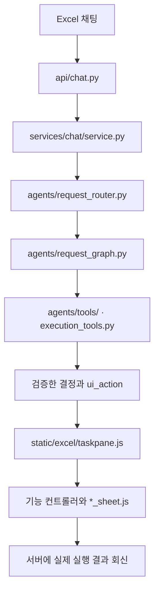

# 코드 지도

기준: 2026-11-20 리팩토링. 표의 코드 경로는 `src/` 기준이다. 현재 사용법은 [사용 안내](usage.md), 실행·테스트는 [README](../README.md)에 있다.

## 전체 흐름

도구가 반환하는 설정과 실제 Excel 쓰기 완료는 다르다. 모델은 행동을 선택하고, 서버는 입력·실행 상태를 검증하며, Excel 코드는 실제 현재 값을 읽고 쓴다. 일반 변경은 미리보기·사용자 적용을 거치며 대표 부호 그룹 연결은 현재 사용자가 100점 대표 부호 연결을 명시한 경우에만 자동 적용 경로를 제공한다.

목표 실행은 `services/agent_runs/service.py`와 `static/excel/chat/agent.js`가 단계 ID로 왕복한다. PDF는 `services/documents/`가 원문을 읽고 `services/investigation/extraction.py`가 조사 조건을 해석한다. Excel 검토 시트 수정 반영은 `documents/investigation.js` → `api/investigation.py` → `services/investigation/service.py`로 연결된다.

## 서버 시작과 외부 연결

| 위치 | 역할 |
| --- | --- |
| `main.py` | FastAPI 생성, 라우트·정적 파일·오류 처리 등록, 메모리 저장소 초기화 |
| `runtime.py` | 환경에 맞는 모델·프롬프트 조립과 수식용 모델 응답 처리 |
| `settings.py`, `config.yml` | 환경 선택과 모델 설정 검증 |
| `models/openai.py`, `llama_cpp.py`, `codex_adapter.py` | OpenAI 호환 서버·내부 모델·Codex CLI 연결 |
| `models/structured.py` | AI 의견과 PDF 추출이 공유하는 입력 예산·분할·모델 호출·구조화 응답 검증 |
| `prompts/loader.py`, `prompts/*.yml` | 프롬프트 읽기, 요청 도구·실행·수식·의견·조사 지시문 |
| `manifest.xml` | Excel 추가 기능의 진입점과 설정 |

루트 `start-external.sh`는 외부 모델용 서버 실행, `scripts/evaluate_routing.py`·`evaluate_agent.py`는 실제 모델을 호출하는 합성 데이터 점검이다.

## 요청 입구와 모델의 도구 선택

| 위치 | 역할 |
| --- | --- |
| `api/router.py` | 기능별 API 등록 |
| `api/chat.py` | 대화 생성·조회·채팅·AI 의견·중지·진행 조회 |
| `api/agent_runs.py` | 목표 실행 조회·진행·작업 연결·일시 중지 |
| `api/operations.py`, `operation_jobs.py` | 계산 요청과 정제 작업 생성·미리보기·쓰기 시작·완료 기록 |
| `api/formula_jobs.py` | 수식 계획·승인·완료·완료 미확인 처리 |
| `api/documents.py`, `investigation.py` | PDF 첨부·조회·연결과 조사 조건 추출·검토 반영 |
| `api/write_recovery.py` | 쓰기 증거·현재 결과 확인 |
| `api/taskpane.py` | 화면 제공, JS·CSS 내용 해시, 공통 오류 문구 삽입 |
| `api/schemas.py`, `errors.py` | 채팅 요청·응답 계약, 입력·서비스 오류 응답 |
| `agents/request_router.py` | 도구 반환값을 결정 자료형으로 검사하고 현재 작업과 대조 |
| `agents/request_graph.py` | 모델 호출 → 도구 실행 → 입력 오류 수정 기회, 진단 로그 |
| `agents/request_tools.py` | 문맥별 도구 노출 조건과 기존 순서 조립 |
| `agents/tools/conversation.py` | 일반 답변·확인 질문·목표 시작·재개 |
| `agents/tools/workspace.py` | 작업 시작·범위 변경·열 역할·PDF 검토·AI 의견 요청 |
| `agents/tools/operations.py` | 정제·치환·분리·대표값·거래처 매칭·유사도와 출력 설정 |
| `agents/execution_tools.py` | 연속 실행용 실제 조회·비교·수식·대표 부호 그룹 연결, 일반 도구 재사용 |

`services/agent_runs/service.py`의 `validate_code_grouping_request`는 현재 사용자 원문 인용을 검증한다. `agents/execution_tools.py`의 도구 노출과 `request_graph.py`의 `prompts/code_grouping.yml` 추가도 이 요청 여부를 따른다. 일반 회사명 매칭 요청에는 대표 부호 연결을 붙이지 않는다.

도구를 추가하면 정의만 추가해서 끝내지 않는다. 결정 검증, `services/chat/service.py`의 `decision_action`, API 응답 형식, `taskpane.js`의 전달 경로, 실행 기능, 프롬프트·테스트까지 확인한다.

## 업무 처리와 저장 상태

| 위치 | 역할 |
| --- | --- |
| `services/chat/service.py` | 대화 이력·작업 문맥 구성, 요청 라우팅, 결정 → 화면 동작 변환 |
| `services/chat/state.py`, `services/chat/actions.py` | 대화 작업 상태와 문서·작업표·수식 위치 변경 자료형 |
| `services/agent_runs/schemas.py` | 목표 실행 요청·Excel 응답·메모리 실행 상태 |
| `services/agent_runs/service.py` | 시작·재개·작업 연결·조회 결과 검증·다음 단계·중복 실행 방지 |
| `services/investigation/schemas.py` | 조사 대상·근거·조건·검토 요청과 저장 상태 |
| `services/investigation/extraction.py` | PDF 표·모델 추출, 분할 입력, 근거 검증, 전체 성공 후 저장 |
| `services/investigation/service.py` | 수정 충돌 검사·조건 저장·작업표 연결·검토 반영·조사 문맥 |
| `services/operations/schemas.py` | 정제 설정·입출력·행 조건·작업표 문맥 검증 |
| `services/operations/rules.py`, `service.py` | 문자열 규칙·후보 추출과 실제 연산 결과 계산 |
| `services/operations/jobs.py` | 정제 작업·미리보기·적용 상태와 실행 이력 |
| `services/formula/schemas.py`, `planner.py`, `service.py` | 수식 데이터 형식, 계획 생성·범위 검증, 승인·완료 상태 |
| `services/documents/schemas.py`, `service.py`, `extractor.py` | PDF 자료형·용량 검사·별도 프로세스 추출 |
| `services/documents/tables.py`, `chunks.py` | 연속 표 인식·셀 분해·원문 근거 분할 |
| `services/recommendation/schemas.py`, `selection.py` | AI 의견 요청·결과 형식, 모델규격 상위 조합 선정 |
| `services/recommendation/analysis.py`, `service.py` | 분석·제안 검증과 대화 요청·결과 연결 |
| `services/workspace.py` | 기능 공통의 실제 열 ID 선택·검증 |
| `services/similarity.py`, `supplier_matching.py` | 유사도 계산, 반영된 PDF 거래처 기준과 실제 값 비교 |
| `services/execution_history.py` | 같은 작업표의 정제·수식 이력을 모델 문맥에 연결 |
| `services/write_recovery.py` | 쓰기 증거와 현재 셀 관측으로 완료 여부 판정 |
| `services/errors.py`, `error_messages.json`, `debug_log.py` | 오류 종류·공통 문구·콘솔 진단 로그 |
| `repositories/conversation_repository.py` | 대화·문서·조사 상태, 요청 취소와 대화 잠금 |

`services/group_review.py`는 보류 기능의 요청 형식이다. `StrictModel`·`WorkspaceContext` 등 기존 연산 스키마는 이번에 추가로 나누지 않았다. 공통 검증을 쓴다는 이유만으로 형식을 전부 새 계층으로 옮기지는 않는다.

## Excel 화면과 실제 셀 처리

`static/excel/` 아래 경로다. `*_sheet.js`는 실제 Excel 접근, `*_ui.js`는 표시, 기능 이름의 `.js`는 진행을 맡는 기존 규칙을 따른다.

| 위치 | 역할 |
| --- | --- |
| `taskpane.html`, `taskpane.css` | 화면 배치와 스크립트 로딩 순서 |
| `taskpane.js` | Office 준비, 컨트롤러 연결, 로컬 명령·서버 동작 전달 |
| `chat/chat.js`, `task_messages.js` | 대화 전송·복원·중지, 채팅 결과·미리보기·적용/취소 |
| `chat/agent.js`, `agent_sheet.js` | 목표 실행 단계 왕복, 실제 행 조회와 재검증 |
| `workspace/workspace.js` | 현재 작업표·대상·마지막 결과 소유, 생성·복원·저장·결과 등록 |
| `workspace/workspace_actions.js` | 범위 계산·역할 지정·원본 열 가져오기. 작업표 상태를 별도로 보관하지 않음 |
| `workspace/workspace_sheet.js`, `workspace_copy.js` | 원본·작업 대상 읽기, 보관 시트·작업표 생성 |
| `workspace/workspace_store.js` | 통합문서 설정에 작업 연결 정보 저장·조회 |
| `workspace/workspace_ui.js`, `workspace_columns.js` | 작업 준비·열 추가 화면과 가져올 열 선택 |
| `workspace/source_columns.js`, `table_reader.js` | 원본 열을 행 ID에 맞춰 추가, 공용 표·열·행 읽기 |
| `workspace/result_dependencies.js` | 입력·범위 변경에 따른 후속 결과 재검토 판단 |
| `operations/operations.js`, `operations_ui.js` | 정제 미리보기·적용·최종 기록과 화면 표시 |
| `operations/operation_jobs.js`, `extraction_suggestions.js` | 서버 정제 작업 통신, 전체 대상 추출 패턴 추천 |
| `operations/operations_sheet.js`, `write_recovery.js` | 조건 행 읽기·셀 쓰기, 쓰기 증거 수집·복구 화면 |
| `formula/formula.js`, `formula_ui.js` | 수식 계획·확인·적용 진행과 표시 |
| `formula/formula_sheet.js`, `workspace_formula.js` | 실제 수식 계산·값 고정, 작업표 입력·출력 범위와 결과 열 식별 |
| `documents/documents.js`, `documents.css` | PDF 첨부·목록·추출내용 패널 |
| `documents/investigation.js` | 조사 연결·조건 추출·검토 시트 수정 반영 |
| `documents/review_sheet.js`, `review_preprocess.js` | Excel 검토 시트 읽기·쓰기와 전처리 확인 |
| `similarity/similarity.js`, `similarity_sheet.js` | 유사도 요청·채팅 결과와 결과 시트 작성 |
| `recommendation/recommendation.js`, `recommendation_sheet.js` | 의견 대상 검증·전체 행 읽기·상위 조합 준비 |
| `common/` | API 통신, 마크다운 표시, 공통 오류 문구 |
| `assets/`, `vendor/` | 이미지와 외부 라이브러리. 업무 코드와 구분 |

## 상태와 실패 처리의 경계

- 작업표·대상·마지막 결과는 `workspace.js`가 소유한다. 규칙 모듈은 현재 상태를 받아 사용한다. 범위·역할 저장 실패 복원과 성공한 열별 저장도 컨트롤러가 맡는다.
- 요청 중지·대기 요청은 `chat.js`, 각 미리보기는 `operations.js`·`formula.js`가 관리한다.
- 서버의 단계 상태는 `agent_runs/service.py`, 정제·수식 쓰기 상태는 각 작업 서비스가 관리한다. 실제 결과를 확인하지 않고 완료로 바꾸지 않는다.
- 셀 쓰기는 변경 감지 → 쓰기 전 증거 저장 → 실제 쓰기 → 서버 완료 기록 → 작업표 결과 등록 순서를 보존한다. 완료 미확인 쓰기는 자동 재적용하지 않는다.
- `repositories/`의 메모리 상태와 Excel 통합문서 저장 정보는 별개다. 서버 재시작 후 대화·PDF가 남는다고 가정하지 않는다.

## 이동·추가할 때 확인할 곳

Python import, 테스트 patch 문자열, 평가 스크립트, 프롬프트 상대 경로를 함께 확인한다. 프론트 파일 추가는 `taskpane.html`과 테스트의 로딩 목록, `tests/backend/test_taskpane_assets.py`를 갱신한다. 공용 기능은 소비자보다 먼저, `taskpane.js`는 마지막에 로드한다. 자산 내용 해시는 `api/taskpane.py`가 생성한다.

API 경로·저장 데이터·도구 이름과 인자는 파일 이동만으로 바꾸지 않는다. 수식 쓰기와 정제 적용은 길어도 검증·부분 실패·복구 순서가 한눈에 보여야 하므로 잘게 나누지 않았다.

## 보류 기능

`static/excel/group_review/`는 현재 페이지에서 로드하지 않는다. 도구 등록·화면 연결도 보류 상태이며 코드·테스트·기존 저장 정보는 유지한다. 과거 상세 사용법은 [보관 문서](history.md)다.

## 채팅 패키지와 적용 추적

`services/chat/service.py`는 기존 채팅 처리, `state.py`는 대화 작업 상태, `actions.py`는 화면 동작 형식을 담당한다. 기존 함수·자료형은 유지하고 호출부·테스트·평가 스크립트의 import를 갱신했다.

채팅 ID 전달 → 작업 생성 → 미리보기 → 적용 시작 → Excel 완료 보고 → 복구 확인의 로그는 [로그 안내](logging.md)를 따른다. 에이전트의 `origin_request_id`는 왕복·취소에 쓰는 `request_id`와 별도다. 정제·수식 작업은 선택적인 출처 ID를 보관하고, 서버 API가 기존 상태 전환을 관측한다. 추가 네트워크 요청이나 LangSmith 의존성·연동은 없다.
